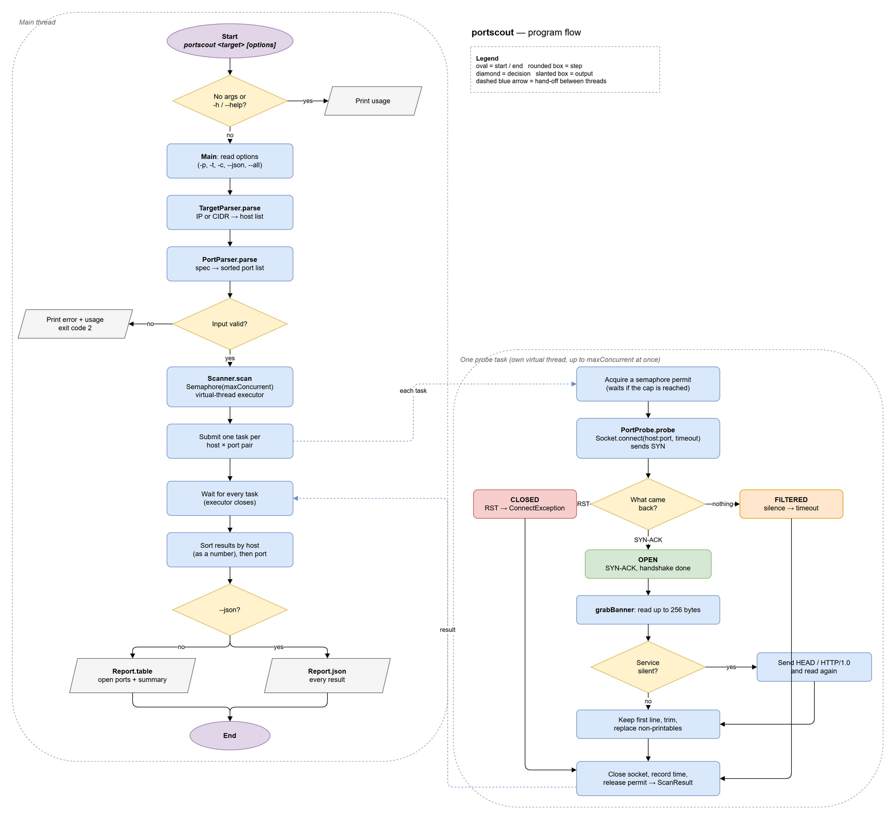
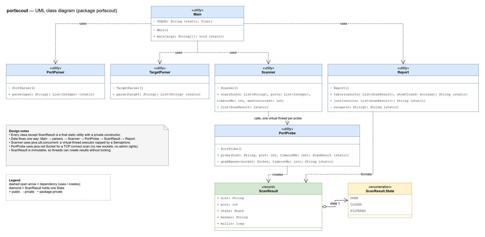

# portscout

A multithreaded TCP port scanner in Java to understand how tools like nmap work: it maps open ports across a subnet, identifies services from their banners, and tells closed ports apart from firewalled ones.

> Only scan hosts you own or have written permission to scan. `scanme.nmap.org` allows light scanning for testing.

## Overview

### What

A command-line tool that takes an IPv4 address or subnet (e.g. `192.168.1.0/24`) and a list of ports, tries to connect to each one, and reports which ports are **open**, **closed** or **filtered**, plus the banner of the service behind each open port.

### Problem

Every device on a network listens on numbered **ports**: 22 is usually SSH, 80 and 443 are websites, 3389 is Remote Desktop. Network and security teams constantly need to know *which ports a machine exposes and what is running behind them*:

- **Network engineering:** does the firewall really block what it should? What is on this subnet? Why can't anyone reach this service?
- **Security:** every open port is a possible way in, and a banner such as `SSH-2.0-OpenSSH_7.2` shows the exact version to check against known vulnerabilities.
- **Operations:** find forgotten services, like an old FTP server nobody switched off.

Doing this by hand is slow and unclear:

1. **Slow:** checking ports one at a time means waiting out a full timeout for every port that does not answer. On a firewalled host, 1,024 ports at 500 ms each is over **8 minutes**.
2. **Unclear:** a failed connection alone does not say whether *nothing is listening* or *a firewall is hiding the port*, and those mean very different things.

### Solution

- **TCP connect scan** that reads the packet behaviour: a completed handshake is OPEN, a reset (RST) is CLOSED, silence until the timeout is FILTERED. That turns "it failed" into "nothing there" vs "a firewall is dropping it".
- **Banner grabbing** to identify the service: read the greeting that SSH, FTP and SMTP send, and send an HTTP `HEAD` to services that stay silent.
- **Java 21 virtual threads, capped by a semaphore,** so probes wait on the network in parallel: 1,024 ports at 200 at a time takes about 1,024 ÷ 200 × 0.5 s ≈ **3 seconds** in the worst case instead of 8 minutes (measured: 93x faster on a silent host, see [Benchmarks](#benchmarks)), without exhausting sockets or flooding the target.
- **CIDR parsing** to scan a whole subnet in one command, with safety limits (nothing bigger than a /16, at most 1,000,000 probes).

### Why I built it

nmap already does this well. portscout exists to understand **how it works underneath**, the networking, security and Java skills these jobs are built on:

| Concept | Where it lives |
|---|---|
| TCP three-way handshake (SYN, SYN-ACK, RST) | `PortProbe`: open / closed / filtered |
| Subnetting and CIDR math | `TargetParser`: network and broadcast addresses |
| Service identification | `PortProbe.grabBanner` |
| Firewall behaviour (drop vs refuse) | FILTERED vs CLOSED |
| Concurrency in Java 21 | `Scanner`: virtual threads capped by a semaphore |
| Testing and documentation | 42 JUnit tests, Javadoc, UML, flowchart and the edge cases below |

### Part of a project series

Each project looks at the same network from a different side:

| Project | Language | View | Question it answers |
|---|---|---|---|
| **portscout** (this one) | Java 21 | the attacker's view | What ports are open, and what is running behind them? |
| [**wiresight**](https://github.com/AoceanP/wiresight) | C++20 | the network's view | What is actually on the wire? |
| [**logonwatch**](https://github.com/AoceanP/logonwatch) | C# / .NET 10 | the defender's view | Is someone trying to break in, and did they get in? |
| [**tracekeep**](https://github.com/AoceanP/tracekeep) | Python | the evidence's view | Can the logs still be trusted afterwards? |

They work together: run wiresight on the loopback adapter while portscout scans, and every probe becomes visible. A closed port answers `SYN` with `RST`, an open one completes the `SYN`, `SYN-ACK`, `ACK` handshake, and you can even see portscout's 19-byte banner probe. The full capture is in [wiresight's README](https://github.com/AoceanP/wiresight#example-watching-portscout).

## Setup

### 1. Install the requirements

- **JDK 21 or newer.** Check with `java -version`. If it is missing or older, install [Eclipse Temurin](https://adoptium.net/) and reopen your terminal.
- **Git**, to download the code.

You do **not** need to install Gradle: the included `gradlew` wrapper downloads the right version on first use.

### 2. Get the code

```
git clone https://github.com/AoceanP/portscout.git
cd portscout
```

### 3. Build and run the tests

| Windows (PowerShell or cmd) | macOS / Linux |
|---|---|
| `.\gradlew.bat build` | `./gradlew build` |

The first run downloads Gradle and takes a minute. It ends with `BUILD SUCCESSFUL` once every test passes.

### 4. Scan your own machine

| Windows | macOS / Linux |
|---|---|
| `.\gradlew.bat run --args="127.0.0.1"` | `./gradlew run --args="127.0.0.1"` |

### 5. Optional: install it as a command

| Windows | macOS / Linux |
|---|---|
| `.\gradlew.bat installDist` | `./gradlew installDist` |
| `build\install\portscout\bin\portscout.bat 127.0.0.1` | `build/install/portscout/bin/portscout 127.0.0.1` |

Add that `bin` folder to your `PATH` to run `portscout` from anywhere.

### Troubleshooting

- **`gradlew` is not recognized** (PowerShell): type `.\gradlew.bat`, with the `.\` in front.
- **`JAVA_HOME is not set`** or **`Unsupported class file major version`**: your Java is missing or older than 21; see step 1.
- **Every port shows FILTERED on a remote host:** a firewall is dropping the probes, or the timeout is too short for a slow link; try `-t 2000`.

## Usage

```
portscout <target> [options]
```

| Option | Meaning | Default |
|---|---|---|
| `target` | one IPv4 address, or a CIDR block up to /16, e.g. `192.168.1.0/24` | required |
| `-p, --ports` | ports and ranges, e.g. `22,80,443,8000-8100` | `1-1024` |
| `-t, --timeout` | connect and read timeout in ms | `500` |
| `-c, --concurrency` | probes running at once | `200` |
| `--json` | JSON output, including closed and filtered ports | off |
| `--all` | also list closed and filtered ports in the table | off |

Example, a scan of a Windows PC:

```
> portscout 127.0.0.1 -p 1-1024
HOST             PORT   STATE     MS     BANNER
127.0.0.1        135    OPEN      1009
127.0.0.1        445    OPEN      501
2 open of 1024 probed
scanned 1 host(s) x 1024 port(s) in 1053 ms
```

Ports 135 (RPC) and 445 (SMB file sharing) are open on every Windows PC; a home router keeps them hidden from the internet. Neither sends a banner, so the time shown includes waiting for one.

## How it works

- **TCP connect scan:** open = handshake completes, closed = RST, filtered = no reply before the timeout.
- **Banner grabbing:** read the greeting that SSH, FTP and SMTP send first; for silent services send an HTTP `HEAD` and read the status line. Only the first printable line is kept, because banners are untrusted remote data.
- **Concurrency:** a semaphore permit is taken before each virtual thread starts, so at most `-c` probes exist at once and the scan never exhausts sockets.
- **Safety limits:** blocks bigger than a /16 and scans over 1,000,000 probes are refused.

## Privacy and data

Scan results can reveal weak spots in a network, so portscout keeps nothing:

- **No storage:** no database, no log files, no history. Results are printed once to the terminal and exist only in memory until the program exits.
- **No network calls** other than the probes you ask for: no telemetry, no update checks, no lookups.
- **No dependencies at runtime:** only the Java standard library, so no third-party code can collect or send anything.

If you save output yourself (for example `portscout 192.168.1.0/24 --json > scan.json`), treat that file as sensitive and don't commit it.

## Design

### Program flow

The main thread parses the input and hands one task per host and port to a pool of virtual threads. Each task runs a TCP connect scan and, for open ports, grabs the banner.



### UML class diagram



Both diagrams are drawn in draw.io: [portscout-flow.drawio](docs/portscout-flow.drawio) and [portscout-uml.drawio](docs/portscout-uml.drawio). Open them in draw.io or at app.diagrams.net to edit, then export to PNG with the same name.

## Benchmarks

Measured on Windows 11 with Java 25, default 500 ms timeout.

### A host that does not answer (worst case)

`192.0.2.1` is a reserved address that never replies, so every probe waits out the full timeout, exactly like a host behind a firewall that drops packets. 100 ports:

| Concurrency (`-c`) | Time | Speed-up |
|---|---|---|
| 1 | 50,176 ms | 1x |
| 10 | 5,043 ms | 10x |
| 50 | 1,040 ms | 48x |
| 100 | 538 ms | 93x |

The time follows `ports × timeout ÷ concurrency` almost exactly (100 × 0.5 s ÷ 10 = 5 s), because each probe spends nearly all its time waiting, not computing. Virtual threads make that waiting cheap enough to run hundreds at once.

### Your own machine (best case)

`127.0.0.1`, ports 1 to 1024. Closed ports answer with a reset in about 2 ms, so even one at a time is quick:

| Concurrency (`-c`) | Time |
|---|---|
| 1 | 3,831 ms |
| 50 | 1,053 ms |
| 500 | 1,050 ms |

Past 50 there is no gain: the scan can never finish faster than its slowest probe, here port 135, which waits about 1 s for a banner that never comes.

## Roadmap

- [x] PortParser
- [x] TargetParser (CIDR)
- [x] PortProbe (connect scan + banners)
- [x] Scanner (virtual threads + semaphore)
- [x] Benchmarks
- [ ] Compare against `nmap -sT`
- [ ] Stretch: UDP probes for DNS (53) and NTP (123)
- [ ] Stretch: map banners to known versions and flag outdated ones

## License

MIT, Copyright (c) 2026 AoceanP. See [LICENSE](LICENSE).

## Edge cases

Every case below is covered by a test (in [`EdgeCaseTest`](src/test/java/portscout/EdgeCaseTest.java) unless another class is named) or, for the command line, was checked by hand.

### Ports

| Input | Result | Why |
|---|---|---|
| `1`, `65535`, `443-443` | accepted | the lowest and highest TCP ports, and a one-port range, are all valid |
| `0`, `65536` | refused | port 0 is reserved; ports are 16-bit (`PortParserTest`) |
| `080` | port 80 | read as decimal, never octal |
| `-5` | refused | looks like a range with no start, so it must not quietly scan 1 to 5 |
| `100-50` | refused | a backwards range is a typo (`PortParserTest`) |
| `80,` `80-` `1-2-3` | refused | typos fail loudly instead of being ignored (`PortParserTest`) |
| ` 80 , 22,80 ` | `22, 80` | spaces ignored, duplicates removed, sorted (`PortParserTest`) |

### Targets

| Input | Result | Why |
|---|---|---|
| `10.0.0.0/16` | 65,534 hosts | the biggest block allowed; `/15` and larger are refused so nobody scans a huge network by accident |
| `192.168.1.77/24` | same as `192.168.1.0/24` | host bits are masked off (`TargetParserTest`) |
| `10.0.0.0/31`, `/32` | every address | point-to-point and single-host blocks have no network or broadcast address, RFC 3021 (`TargetParserTest`) |
| `255.255.255.0/30` | `.1` and `.2` | above 127.255.255.255 a Java `int` is negative, so the math is done unsigned (`TargetParserTest`) |
| `010.0.0.008` | `10.0.0.8` | some C libraries read `010` as octal 8, a known way to slip past address filters; portscout always reads decimal |
| `  10.0.0.1  ` | `10.0.0.1` | surrounding spaces from copy and paste are trimmed |
| `0.0.0.0`, `255.255.255.255` | accepted | valid IPv4 text; what a connect does is up to the operating system |
| `10.+1.0.1`, `10..0.1`, `256.1.1.1`, `example` | refused | `Integer.parseInt` accepts `+1`, so octets are checked as digits only (`TargetParserTest`) |

### Probes and banners

| Situation | Result | Why |
|---|---|---|
| Service greets first (SSH, FTP) | OPEN with banner | read straight away (`PortProbeTest`) |
| Service waits for a request (HTTP) | OPEN with status line | after one silent read timeout, a `HEAD` request is sent (`PortProbeTest`) |
| Service accepts and hangs up at once | OPEN, empty banner | the port is open even if nothing is said |
| Service never answers, even to `HEAD` | OPEN, empty banner, about 2 timeouts | every read has a timeout, so a probe can never hang |
| Banner over 256 bytes | cut to 256 | a chatty or hostile service cannot flood the report |
| Banner with control characters | trimmed at the edges, `.` inside | banners are untrusted remote data (`PortProbeTest`) |
| Banner that is only a line break | empty | whitespace is not a banner |
| Banner with `"` or `\` | escaped in JSON | a server cannot break or inject into the JSON output (`ReportTest`) |
| Nothing listening | CLOSED | the host answers the SYN with a RST (`PortProbeTest`) |
| No reply at all (`192.0.2.1`) | FILTERED | a reserved, never-routed address behaves like a firewall that drops packets (`PortProbeTest`) |

### Scanner and output

| Situation | Result | Why |
|---|---|---|
| `-c 1` | runs one probe at a time | fully sequential still finishes |
| `-c 10000` with 2 ports | 2 results | the cap only limits; it never adds threads |
| `-c 0` | refused | at least one probe must be allowed to run (`PortProbeTest`) |
| More than 1,000,000 probes | refused before any socket opens | e.g. a /16 with 16 ports; keeps memory bounded |
| Hosts `.10`, `.9`, `.1` | sorted `.1`, `.9`, `.10` | sorted as numbers, not text |
| Empty scan | `0 open of 0 probed` / `[]` | "nothing found" prints cleanly |

### Command line (checked by hand)

| Command | Result |
|---|---|
| `portscout` or `portscout -h` | prints usage |
| `portscout 127.0.0.1 -p` | `error: -p needs a value`, exit code 2 |
| `portscout 127.0.0.1 -t 0` | `error: timeout and concurrency must be at least 1`, exit code 2 |
| `portscout 127.0.0.1 -t abc` | `error: -t needs a whole number, got 'abc'`, exit code 2 |
| `portscout 10.0.0.0/8` | `error: /8 is too big to scan; use /16 or smaller`, exit code 2 |
| `portscout 127.0.0.1 --bogus` | `error: unknown option --bogus`, exit code 2 |
